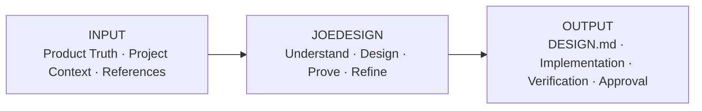
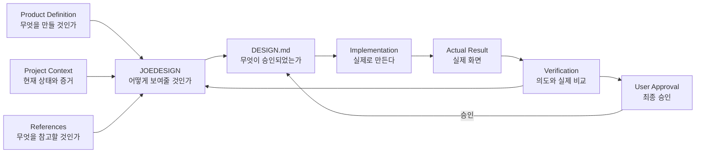
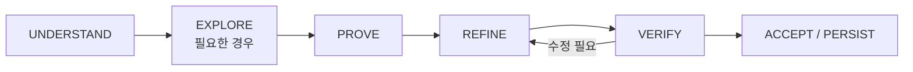
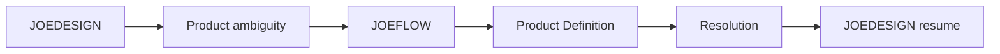

# JOEDESIGN Operating Model v1

**Status:** Canonical operating-model candidate  
**Purpose:** JOEDESIGN의 역할, 입력, 출력, 권위 경계와 작업 흐름을 한눈에 설명한다.

---

## 1. Executive Summary

> **제품 의미를 입력받아 → 시각 방향을 설계하고 → 실제 결과로 검증한 뒤 → 승인된 디자인을 프로젝트 기준으로 남긴다.**



---

## 2. System Roles

### 2.1 Input Layer

| 역할 | 책임 |
|---|---|
| **Product Definition** | 제품의 기능, 정보 구조, 상태, 행동 의미를 정의한다. |
| **Project Context** | 현재 구현, 기존 디자인, 승인·거절 이력, 사용자 요청을 제공한다. |
| **References** | 필요한 경우 외부 디자인 관계를 보조 입력으로 제공한다. |

### 2.2 Design Layer

| 역할 | 책임 |
|---|---|
| **JOEDESIGN** | 승인된 제품 의미를 시각적 위계, 흐름, 구성, 타이포그래피, 색, 이미지, 반응형 표현으로 설계한다. |
| **Craft Core** | JOEDESIGN 자체의 디자인 판단 기준을 제공한다. |
| **Reference Intelligence** | 레퍼런스에서 필요한 관계만 추출하고, 현재 프로젝트에 맞게 번역한다. |

### 2.3 Output Layer

| 역할 | 책임 |
|---|---|
| **Project DESIGN.md** | 승인된 Project Visual Truth를 보존한다. |
| **Implementation Bridge** | 승인된 디자인을 구조화된 token/spec 형태로 구현에 연결한다. |
| **Implementation Agent** | 실제 코드를 작성하고 화면을 구현한다. |
| **Actual Runtime** | 실제 만들어진 결과를 제공한다. |
| **Visual Verification** | 의도와 실제 결과의 일치 여부를 판단한다. |
| **User** | 최종 디자인을 승인하거나 거절한다. |

### 2.4 Control Layer

| 역할 | 책임 |
|---|---|
| **JOEFLOW** | 현재 단계, 담당, gate, evidence requirement, re-entry와 다음 행동을 관리한다. |

---

## 3. End-to-End Flow



---

## 4. JOEDESIGN Internal Process

JOEDESIGN은 하나의 public entrypoint만 제공한다. 내부 단계는 필요할 때만 사용한다.



- **UNDERSTAND:** Product Truth, DESIGN.md, 현재 구현, 승인·거절 evidence를 확인한다.
- **EXPLORE:** 방향이 미정일 때만 2–3개의 materially distinct 방향을 탐색한다.
- **PROVE:** 가장 작은 실제 target-medium proof를 만든다.
- **REFINE:** 정확한 문제만 bounded change로 수정한다.
- **VERIFY:** 실제 render를 관찰해 PASS / FAIL / UNVERIFIED를 판단한다.
- **ACCEPT / PERSIST:** 사용자 승인 후 Project DESIGN.md에 Visual Truth를 반영한다.

---

## 5. Authority Order

```text
1. Product Truth
2. APPROVED Project DESIGN.md
3. JOEDESIGN Craft Core
4. Selected Project References
5. JOE Default Taste
```

상위 권위는 하위 기준으로 덮어쓸 수 없다.

- Product Definition은 제품 의미를 소유한다.
- JOEDESIGN은 시각적 표현을 소유한다.
- Reference는 보조 입력이며 authority가 아니다.
- Implementation Agent는 승인된 의미와 디자인을 구현한다.
- User만 material visual direction의 최종 승인을 부여한다.

---

## 6. Craft Core

Craft Core는 JOEDESIGN 자체의 디자인 판단 기준이다.

### 현재 핵심

- Visual Hierarchy
- Visual Flow
- Semantic Grouping
- Spatial Rhythm
- Typography & Scale

### 다음 확장 후보

- Contrast / Color Hierarchy
- Imagery / Focal Ownership
- Composition
- Responsive Translation
- Anti-template / Distinctiveness
- Optical Refinement

핵심 원칙:

```text
Hierarchy before decoration.
System before one-off values.
Actual observation before Visual PASS.
```

---

## 7. Reference Intelligence

Reference Intelligence는 외부 디자인을 복사하는 기능이 아니다.

```text
Reference
→ 필요한 관계 추출
→ 현재 프로젝트로 번역
→ 실제 Proof
→ 사용자 승인
→ Project DESIGN.md
```

Material adoption일 때만 필요에 따라 아래를 확인한다.

```text
SOURCE
EVIDENCE QUALITY
KNOWN / UNKNOWN
TAKE / DO NOT TAKE
WHY
APPLIES TO
```

### External Sources

- **oh-my-design Builder:** primary structured reference source 후보
- **awesome-design-md:** secondary reference corpus 후보
- **User-supplied references:** project-specific reference input

외부 corpus는 runtime dependency가 아니며 자동으로 authority가 되지 않는다.

---

## 8. DESIGN.md

Project root `DESIGN.md`는 승인된 Project Visual Truth를 저장한다.

```text
ABSENT
→ DRAFT Rev 1
→ Proof
→ User Approval
→ APPROVED Rev 1
```

Material revision:

```text
APPROVED Rev N
→ DRAFT Rev N+1
→ Proof
→ User Approval
→ APPROVED Rev N+1
```

새 Draft는 승인되기 전까지 기존 APPROVED authority를 대체하지 않는다.

---

## 9. Implementation Bridge

Implementation Bridge는 Craft Core와 별도 영역이다.

목적:

```text
Approved DESIGN.md
→ Structured Design State
→ Token / Lint / Diff / Export
→ Implementation Agent
```

Google Stitch / `design.md` 계열의 token, lint, diff, CSS/Tailwind/DTCG export 방식은 이 영역의 interoperability 참고 대상으로 둔다.

Google tooling 자체를 JOEDESIGN runtime dependency로 강제하지 않는다.

---

## 10. Verification Model

```text
Technical PASS
≠ Product Conformance PASS
≠ Visual Conformance PASS
≠ User Acceptance
```

Visual verification:

```text
Expected Observable
→ Actual Observed Fact
→ PASS / FAIL / UNVERIFIED
```

Build 성공, DOM 존재, token 존재, screenshot 파일 존재만으로 Visual PASS를 선언하지 않는다.

---

## 11. Re-entry

디자인 중 제품 의미가 불명확하면 JOEDESIGN이 임의로 결정하지 않는다.



영향받는 범위만 되돌리고 전체 workflow를 다시 시작하지 않는다.

---

## 12. Scope Control

v0.1에서 의도적으로 제외한다.

- reference corpus bundle
- persistent reference DB / vector DB
- automatic brand matcher / reference router
- competitor plugin runtime dependency
- giant design-rule database
- 별도 public visual-check skill
- JOEFLOW 기능 내장
- Figma / Framer clone

원칙:

> **Risk가 클수록 검증을 강화하고, 작은 작업일수록 절차를 줄인다.**

---

## 13. Operating Definition

> **JOEDESIGN은 승인된 제품 의미와 프로젝트 맥락을 바탕으로 시각적 방향을 설계하고, 자체 Craft Intelligence와 필요한 Reference Intelligence를 사용해 실제 결과를 검증·정제하며, 사용자가 승인한 디자인을 Project Visual Truth로 정착시키는 AI 디자인 시스템이다.**
